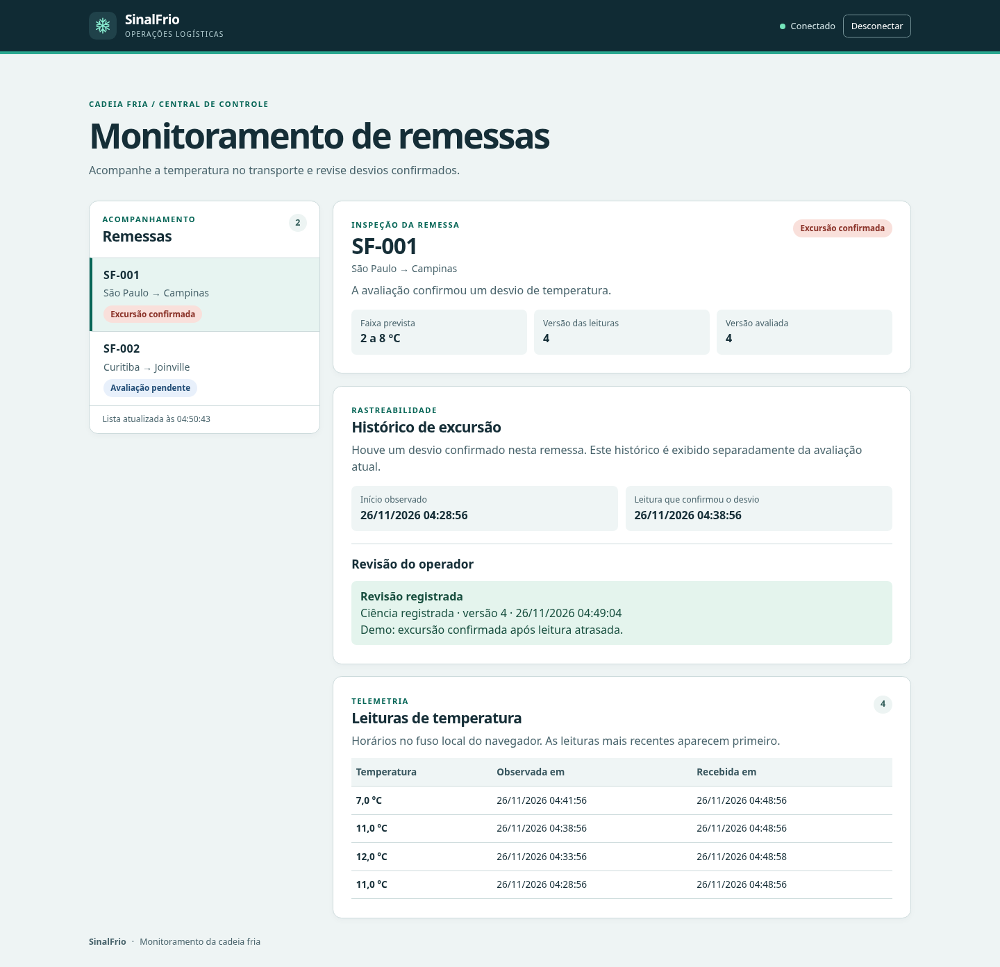

# SinalFrio

**Operação de transportes refrigerados com leituras atrasadas, alertas e revisão humana.** Um sensor perdeu a conexão; ao voltar, envia uma amostra que muda a avaliação de uma viagem. A temperatura atual pode estar normal e, ainda assim, o histórico exigir revisão.



## Execute localmente

Pré-requisitos: Docker com Compose e Python 3. Os bancos e a fila não são publicados na rede. O único ponto de entrada é `http://127.0.0.1:5186`.

```sh
python3 scripts/bootstrap.py
docker compose up -d --build --wait
```

Use a chave `SINALFRIO_OPERATOR_TOKEN` do `.env` local no painel, sem publicá-la. A interface não guarda a chave após fechar ou recarregar a página. A descrição OpenAPI fica em `/openapi/v1.json`; ela não substitui a autorização de leitura e escrita da API.

Em outro terminal, com a base recém-criada, simule o sensor:

```sh
python3 scripts/demo.py --resilience
```

O script envia três leituras que deixam uma lacuna na medição. Em seguida, para o RabbitMQ, envia a leitura atrasada e confirma que a API a aceitou sem avaliar. Quando o broker volta, o histórico acusa **um desvio de dez minutos**, embora a leitura mais recente seja **7 °C**. O script também registra uma revisão; ela aparece no painel. A demo exige dados iniciais limpos e nunca os apaga.

A avaliação é assíncrona. O painel compara duas versões: a última leitura aceita e a última avaliação. Uma diferença significa que ainda há trabalho a processar, não que a carga esteja fora de risco.

## Como o sistema é dividido

- **ASP.NET Core 10 e C# 14:** controllers e DTOs HTTP; serviços coordenam ingestão, avaliação e revisão. A regra térmica não depende de framework.
- **EF Core e PostgreSQL:** identidade e ordem das leituras, controle de concorrência, histórico de revisões e outbox transacional.
- **RabbitMQ e Worker Service:** publicam e processam o evento que dispara a avaliação, fora da requisição HTTP.
- **Angular 22:** painel de operações com leitura atual, horários de medição e recebimento, estado da avaliação e última revisão.

Veja as [decisões de arquitetura](docs/arquitetura.md), o [contrato da API](docs/api.md) e a [operação local](docs/operacao.md). Os dados, os limites de temperatura e os critérios da demo são fictícios. O sistema sinaliza condições para revisão: não homologa sensores, não certifica a qualidade da carga e não decide descarte ou liberação.
