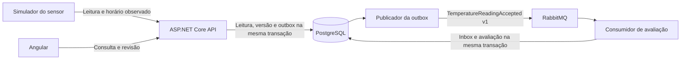

# Arquitetura e garantias

A viagem é a unidade de concorrência. Um equipamento envia leituras relativas à sua viagem; um operador consulta a operação e registra revisão. O produto é um único backend modular com dois processos, não vários serviços de negócio com bancos isolados.

## Responsabilidades

| Projeto | Responsabilidade |
| --- | --- |
| `SinalFrio.Api` | Transporte HTTP, DTOs de entrada e saída, autenticação, políticas de autorização, tradução para respostas `ProblemDetails`. |
| `SinalFrio.Core` | Vocabulário da operação, regra que decide quando há evidência suficiente, casos de uso e portas necessárias. |
| `SinalFrio.Infrastructure` | Persistência em PostgreSQL, mapeamentos e migrations do EF Core. |
| `SinalFrio.Contracts` | Contrato independente de integração. Não expõe entidade do EF nem DTO HTTP. |
| `SinalFrio.Worker` | Publicador da outbox, conexão RabbitMQ, política de tratamento de mensagens e consumidor. |

Não há uma convenção única que toda aplicação .NET deve seguir. O [Microsoft Learn documenta controllers e Minimal APIs](https://learn.microsoft.com/en-us/aspnet/core/web-api/?view=aspnetcore-10.0); controllers foram escolhidos aqui para tornar contratos e papéis visíveis. O alvo `net10.0` usa C# 14 e a [linha LTS](https://dotnet.microsoft.com/en-us/platform/support/policy). A estrutura separa responsabilidades; não exige uma interface para cada classe, repository genérico em cima do EF, mediador global ou mensageria para uma consulta síncrona.

## Hora observada e hora recebida

- `observedAt`: quando o sensor mediu. É a referência para reconstruir o histórico.
- `receivedAt`: quando a API gravou. Mostra atraso sem mudar a ordem das medições.
- Leituras na faixa ou em lados opostos dela não compõem uma sequência fora da faixa. Um intervalo acima de cinco minutos quebra a sequência. Uma lacuna ou um desvio breve, sem duração suficiente, não é evidência de normalidade.
- `readingVersion` aumenta quando uma leitura nova é aceita. `evaluatedVersion` identifica o conjunto já avaliado. A revisão humana usa a versão esperada e não é automaticamente apagada por novas leituras.

O [GS1 EPCIS](https://gs1.org/epcis) descreve dados de sensores com horário em cadeias de transporte sob controle de temperatura. A aplicação não implementa o padrão nem demonstra conformidade regulatória.

## Fronteiras transacionais

1. A API valida escopo, formato e unicidade, então grava a leitura e uma mensagem na mesma transação. O `202` indica aceitação durável, não avaliação concluída. O RabbitMQ pode estar temporariamente indisponível.
2. O publicador só marca o registro depois de confirmar a entrega ao broker. Se o processo cair entre confirmação e marcação, pode republicar. Essa janela existe também com [publisher confirms](https://www.rabbitmq.com/docs/reliability).
3. O consumidor considera as leituras persistidas, não a ordem das entregas. Confirma a mensagem depois de persistir o efeito e a identidade processada. Reentregas não devem duplicar o efeito.
4. A revisão é um comando separado e só vale para a versão avaliada atual. Uma nova leitura pode tornar uma revisão antiga desatualizada sem reescrever a decisão anterior.

Não se promete entrega exatamente uma vez, fila com ordenação global, processamento em tempo real ou consistência imediata do painel. O escopo usa um limite de leituras por viagem para tornar a reavaliação do conjunto verificável; para ingestão de alto volume seria necessário avaliar particionamento, retenção e cálculo incremental.

## Fronteiras de confiança

O sensor não escolhe a identidade nem obtém acesso de operador. O operador não ingere telemetria. O navegador não decide a regra de negócio e não se conecta a banco ou fila. As chaves descartáveis servem a um laboratório em loopback e não substituem provedor de identidade, TLS e credenciais de dispositivo para produção. O migrador tem DDL; o processo de runtime não usa o administrador do PostgreSQL.
